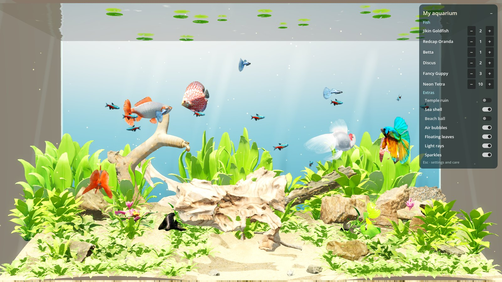

# jev-aquarium



A cozy aquarium toy built with Godot 4.7: one tank view, colourful fish, and play with the mouse
(feed, tap the glass, stir the water). It is aimed at a commercial-quality Steam release, but right
now it is an **experiment**.

## Why this exists

The question behind the project: can someone who is not a 3D artist, animator or sound designer get
a game to commercial quality by directing an AI coding agent (Claude Code) through the whole
pipeline? That covers code, shaders, asset sourcing, Blender processing, animation and testing.

Everything here was made that way. The human picked the direction and judged the result ("the fish
look like robots", "too dark and sad", "fish go through the rocks"). The agent did the work and
checked it with screenshots, recorded frames and measurements.

Status: playable prototype. The look and the swimming are good but not finished; there is no sound
yet.

## Run

Requires [Godot 4.7](https://godotengine.org/download).

```bash
godot --path .
```

The project targets the Vulkan renderer (Forward+). On a machine where Vulkan cannot open a window,
add a local `override.cfg` (ignored by git) to use OpenGL instead:

```ini
[rendering]
renderer/rendering_method="gl_compatibility"
```

## Controls

| Input | What happens |
|---|---|
| Move the mouse | Curious fish come to your finger on the glass; shy ones keep away |
| Click | Tap the glass: a ring, a startle, then curious fish come back to look |
| Double-click | Sprinkle food; fish compete for it, and pellets land on sand, wood and rocks |
| Triple-click | Bubble burst, and a beach ball the fish nudge around |
| Drag | Stir the water: plants, leaves, food and fish follow the current |
| Top-right panel | Add or remove fish by type; switch extras on and off |
| Esc / right-click | Settings: random or chosen population, every scenery piece, care mode, memorial |
| F1 / F11 | Fish names and hunger / fullscreen |

Hunger keeps running while the game is closed. A fish becomes hungry after about 8 hours, starving
after about 36, and dies after about 72 without food. Relaxed mode halves the pace; Peaceful mode
never lets a fish die.

## Dev stack

| Part | What is used |
|---|---|
| Engine | Godot 4.7, GDScript, custom spatial shaders |
| Fish | Artist-made models from Sketchfab (CC BY 4.0) with swim cycles re-baked in Blender |
| Scenery | Poly Haven scans (CC0) and Sketchfab aquarium plants (CC BY 4.0) |
| Asset processing | Headless Blender 4.0 Python scripts in `tools/` |
| Behaviour | Steering (wander, school, curiosity, startle, feeding, play), kick-and-glide locomotion, ray "whiskers" against trimesh collision |
| Animation | Lighthill travelling body wave baked per model, playback speed tied to real tail-beat frequency, plus live turn curvature (`SkeletonModifier3D`) |
| Look | Caustics on every surface, planar-reflection water surface, sun shafts, particles, depth haze |
| Testing | Scripted input on a private Xvfb display, Godot movie-maker mode for exact 30 fps frames, per-frame motion logs |
| Concept art | Generated in ChatGPT from prompts in `concept/` |

## How the assets are made

1. **Pick:** search Sketchfab and Poly Haven by license, faces and animation through their APIs, and compare thumbnails.
2. **Measure:** `tools/blender_inspect.py` and `tools/blender_bones.py` report bounds, eyes and skeletons.
3. **Clean:** `tools/prep_scenery.py` splits packs, reduces polygons and normalises size; `clean_discus.py` and `fix_guppy.py` repair model defects.
4. **Animate:** `tools/bake_swim.py` keys a travelling body wave into each fish and renders top-view proof frames.
5. **Check in game:** `tools/render_glb.tscn` shows models side by side; `tools/shot.sh` and the test driver record scripted scenes.
6. **Credit:** `tools/make_credits.py` writes `CREDITS.md` from the metadata embedded in each model.

## Difficulties met (and what worked)

- **Code-built art is not commercial art.** The first prototype generated fish, plants and rocks
  from code, and it read as amateur. Real models from artists and photo scans fixed that in one step.
- **The fish's own animations were not swimming.** Measured per clip: the guppy's rear spine never
  moved, the betta beat once in six seconds, and the neon's tail moved 0.05 body lengths. The answer
  was baking a biologically based body wave (Lighthill model) into each rig.
- **"Robotic" motion has several causes.** Fish sliding sideways, constant speed, metronome tail
  loops, frozen fins while gliding, and swimming only side-on to the glass (where body bending is
  invisible). Fixes, measured each time: velocity along the body, smooth thrust pulses (jerk down
  about 10×), rate-limited turning with banking, tail frequency tied to speed, and surge per stroke.
- **Rigs disagree.** Some models rest standing on their tail, some rest bent, and bone positions can
  sit far from the mesh. Blender's import modes change the rest pose, so a re-export can come out
  rotated. The bake uses the straight bind pose, and the game applies a per-model correction.
- **Small asset traps.** A guppy's eyes floated in front of its nose; a discus trailed a stray strand;
  a plant pack had near-zero node scales; a spec-gloss material lost its texture in Blender; skinned
  bounding boxes in Godot are unreliable.
- **Collision.** Fish passed through wood and rocks until every solid got a trimesh collider and the
  fish got ray whiskers. Measured over 60 s: 0 % of fish-frames inside a solid.
- **Rendering on the dev machine (DGX Spark GB10).** Vulkan could not create a window swapchain while
  a large model server held most of the unified memory, so local runs use OpenGL. The screen texture
  came back empty in the OpenGL renderer, so the water surface uses a mirrored reflection camera.
- **Judging motion without watching live.** The test display renders a few frames per second, so
  smoothness was judged from fixed-fps recordings and numbers: jerk, turn acceleration, tail-rhythm
  steps and penetration.
- **Tooling friction.** Generating images through the Codex CLI did not work from the agent, so
  concept art was made by hand in ChatGPT. A shared Blender session (via MCP) collided with another
  project, so asset work moved to separate headless Blender runs.
- **Mood is a design problem, not a technical one.** The first lit version was "dark and sad".
  Bright daylight, clear water and a backlit blue background changed it to cozy.

## Next

- Sound: soft bubbling, food plops, glass taps, calm music (the biggest missing piece for "cozy").
- Swimming polish: per-species wave strength, stronger body bend in turns, a baked cycle for the discus.
- Look: test and tune the Vulkan (Forward+) renderer on a machine where it runs; nicer surface leaves.
- Content: more species (Tosakin and Moor goldfish are already sourced), decorations, toys.
- Steam: GodotSteam (achievements, cloud saves), performance pass for Steam Deck, store page assets.

## Layout

- `scripts/`: game code. Includes `main.gd` (input), `tank.gd` (camera, light, water), `scenery.gd` (aquascape),
  `fish.gd` (behaviour and locomotion), `swim_spine.gd` (beat strength and turn bend),
  `species.gd` (catalogue), `game.gd` (state, hunger, save), `tank_panel.gd` and `settings_menu.gd` (UI),
  `test_driver.gd` (scripted tests).
- `shaders/`: caustics, water surface, sand, plants, glass, particles, and procedural fish (fallback).
- `assets/`: `raw/` downloads, `fish/` baked fish, `scenery/` prepared pieces, `polyhaven/` and `textures/` scans.
- `tools/`: Blender scripts, inspection scenes, test helpers.
- `concept/`: chosen art direction. `PLAN.md`: plan and decisions.

## Credits and licensing

Third-party models and scans keep their own licenses: CC BY 4.0 works are credited by author in
[CREDITS.md](CREDITS.md), and Poly Haven assets are CC0. A license for the project's own code has
not been chosen yet.
